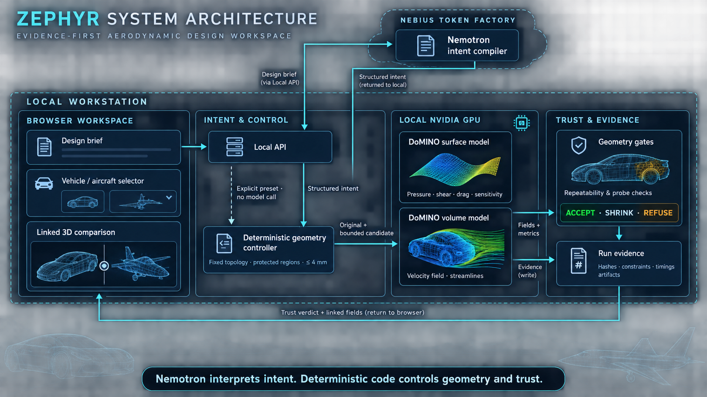

# Zephyr

**Shape the flow.** Zephyr is an evidence-first aerodynamic design workspace that turns a plain-language vehicle brief into a bounded geometry study, runs NVIDIA DoMINO locally, and keeps the result tied to reproducible evidence.


*Current widescreen aircraft workspace. Aircraft flow is experimental; the orange vortices are an explanatory illustration, not a flight-performance result.*

## What it does

- Explore seven cars and two NASA aircraft in one linked 3D workspace.
- [Bring your own car](docs/BRING_YOUR_OWN_CAR.md): import a mesh or approximate a photo with a scaled template, review orientation/size, then run experimental baseline and eligible shape tests.
- Use `nvidia/Nemotron-3-Ultra-550b-a55b` through Nebius Token Factory to compile supported design intent and explain recorded evidence.
- Keep geometry changes deterministic, fixed-topology, protected-region aware, and capped at 4 mm.
- Run the open NVIDIA DoMINO `.mdlus` checkpoints on a local CUDA GPU for surface and volume predictions.
- Compare original and candidate fields while preserving hashes, constraints, timings, and refusal reasons.

The separate [sedan research workflow](docs/SEDAN_RESEARCH.md) evaluates seven
larger parametric morphs with forward-only LHS/TPE search, equal-budget random
controls, repeated finalists and independent CFD comparison. Its live study is
paused at the user's request; the selected approximately 3.33% predicted reduction
is a provisional demo result, with incomplete controls and independent validation. The original
workspace design and aircraft behavior are preserved.

Nemotron does not move vertices or decide whether a result is trustworthy. The geometry controller and acceptance gates remain deterministic.

## Architecture



Optional cloud calls handle intent, evidence Q&A and photo classification/template selection. Geometry preparation and changes, GPU inference, acceptance decisions, and run evidence stay inside the local workstation boundary. Mesh imports work without cloud calls.

## Quick start

The validated path is native Windows with an NVIDIA CUDA GPU, Python 3.12, Node.js 22, Git, PowerShell, and `uv`.

```powershell
git clone https://github.com/ASH1998/zephyr.git
cd zephyr
.\scripts\setup-domino-windows.ps1
npm --prefix frontend ci
Copy-Item .env.example .env
```

Start the backend and frontend in separate PowerShell terminals:

```powershell
& ..\.venv\Scripts\python.exe -m zephyr.local.server --enable-llm --fast-demo --port 8766
```

```powershell
npm --prefix frontend run dev
```

Open <http://127.0.0.1:5173>. Leave off `--enable-llm` for a fully local run with the explicit supported preset.

`--fast-demo` shortens sedan iterations to one sensitivity-directed candidate:
two fresh surface calculations instead of seven, with geometry checks and both
airflow calculations retained. The existing result panel reports the comparison;
skipped calibration stays `not-run` in the evidence. Omit the flag for the full
repeat/probe workflow. Aircraft analysis and saved replays are unchanged.

See the [clean installation guide](docs/INSTALL.md) for prerequisites, model assets, the complete vehicle catalog, verification, and troubleshooting.

## Evidence status

- The native Windows DoMINO capability gate passes on the recorded test system.
- The Nemotron runtime path is verified for live structured brief compilation and evidence-bound Q&A.
- The latest recorded regression run reports 92 Python tests, 45 frontend tests, and the production build passing.
- Accepted means **accepted for further evaluation**, not validated aerodynamics. Independent CFD, physical error bounds, and a transferable trust radius remain pending.
- Aircraft use a car-trained model and support experimental baseline analysis only; they do not support shape iteration.

The detailed status and limitations live in [progress.md](progress.md), [acceptance checks](docs/ACCEPTANCE_CHECKS.md), and [runtime checks](docs/RUNTIME_CHECKS.md).

## Documentation

Start at the [documentation index](docs/README.md). Key guides:

- [Installation](docs/INSTALL.md)
- [Local DoMINO runtime](docs/LOCAL_DOMINO.md)
- [Cars, aircraft, and airflow](docs/CARS_AND_AIRFLOW.md)
- [Nemotron interface](docs/LLM_INTERFACE.md)
- [Sedan research and recorded deployment](docs/SEDAN_RESEARCH.md)
- [60-second demo](docs/DEMO_60_SECONDS.md)

## License

Zephyr source code is available under the [Apache License 2.0](LICENSE). Third-party models, datasets, and visual assets retain their upstream licenses; see [vehicle credits](frontend/public/models/VEHICLE_CREDITS.md) and the pinned artifact manifests before redistribution.
