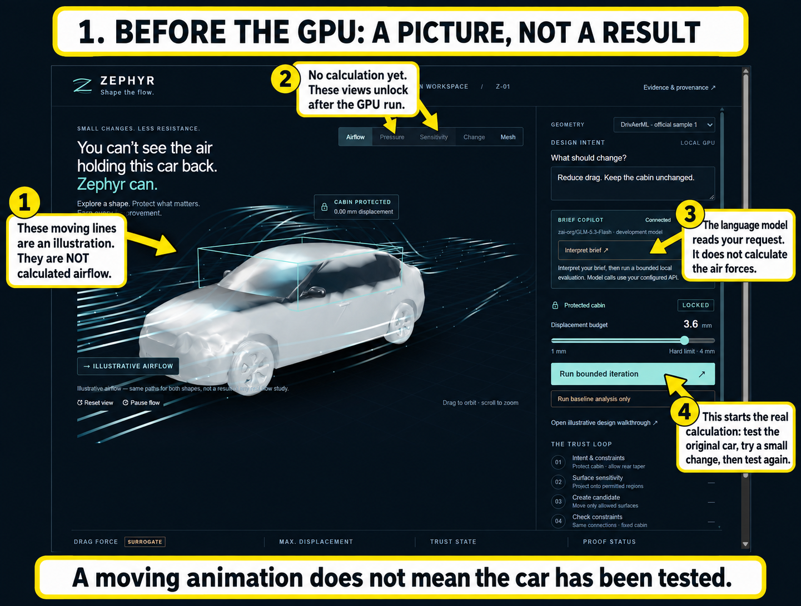
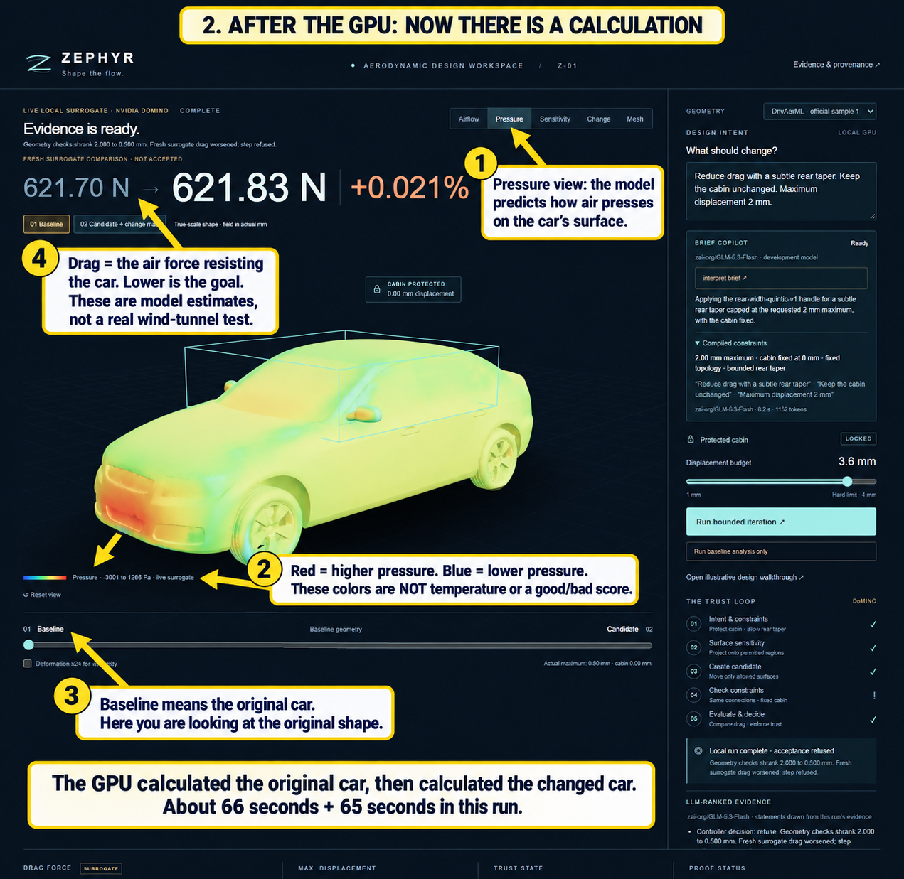
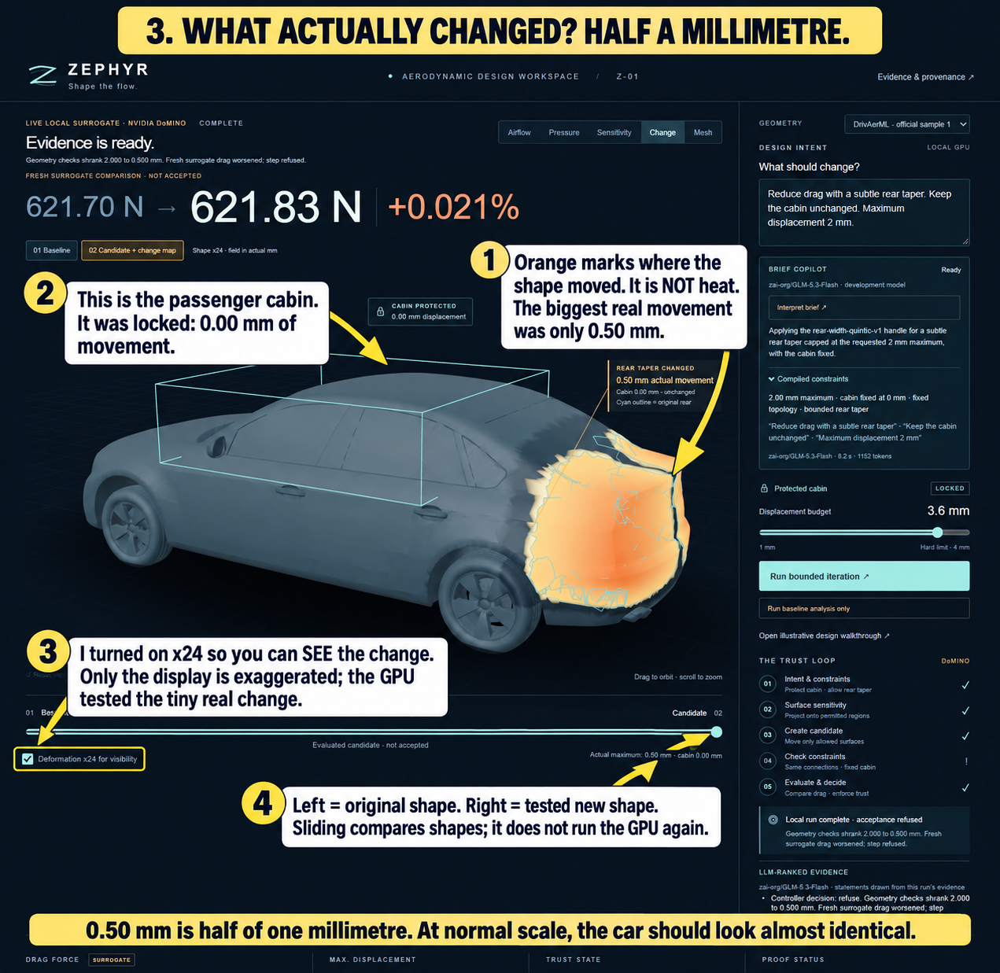
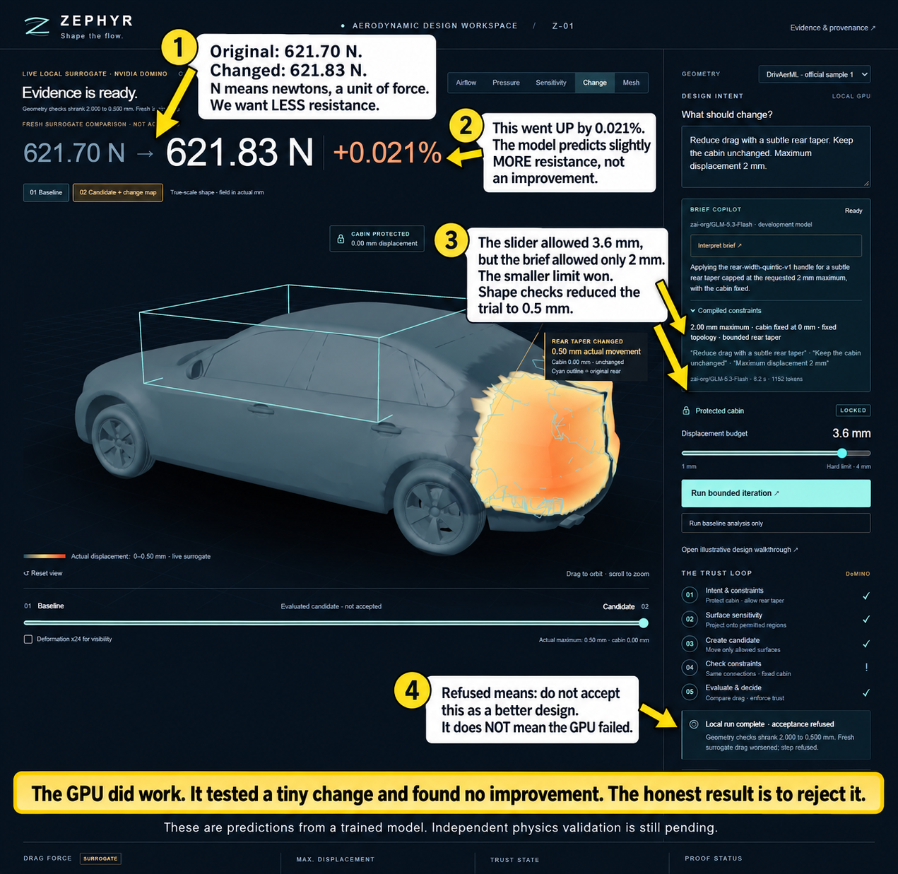

# Understanding the Zephyr screen

These four full-screen annotations were made with the built-in imagegen tool
from actual browser screenshots. The prompts are saved alongside the images as
`01-prompt.txt` through `04-prompt.txt`. No CLI image-generation fallback was used.

## 1. Before the GPU

The car and moving airflow lines are a visual preview. Those lines do not prove
that a calculation happened, and they do not change based on the test result.
The text assistant reads the request. The Run button starts the calculation.

## 2. What the GPU produces

It predicts the air pressure on the original car, then does another calculation
for a slightly changed car. Red and blue indicate higher and lower predicted
pressure, not temperature or a good/bad score. Drag means resistance from the air;
lower drag is the aim. These are model predictions, not wind-tunnel measurements.
The latest run used 66.3 seconds for the original and 65.1 seconds for the changed
car; total run time including preparation and checks was 149.7 seconds.

## 3. Why it looks unchanged

Only the rear was allowed to move. Maximum actual movement was 0.50 mm, half a
millimetre. The cabin stayed fixed. Orange marks where movement happened; it
is not heat. The screenshot has x24 enabled to exaggerate movement on screen.
The GPU always tested the real small movement. The comparison slider switches
between original and changed shapes; it does not launch another calculation.

## 4. Did this change help?

Original predicted drag: 621.695556640625 N.
Changed predicted drag: 621.8261108398438 N.
Difference: approximately +0.021%, slightly worse. It was refused for acceptance.
The slider's 3.6 mm limit was reduced to the brief's stricter 2 mm ceiling, and
shape checks reduced the tested change to 0.5 mm. Refusal is a result, not a GPU
crash. Independent validation and other acceptance checks are still pending.

The app currently tests one restricted rear-body change per run. It does not
yet search through a broad range of car designs or reliably find a better one.
Repeating the same brief and budget can produce the same result. That limitation,
the tiny movement, and the unrelated airflow animation explain why it can feel
as though nothing happened.

Source run: `local-6ff7e744ea2e49acb9130082b805ad8f`.
Exact values were checked against `.local/runs/<run-id>/evidence.json`.
The annotation images are explanatory; the run evidence remains the numeric source.
